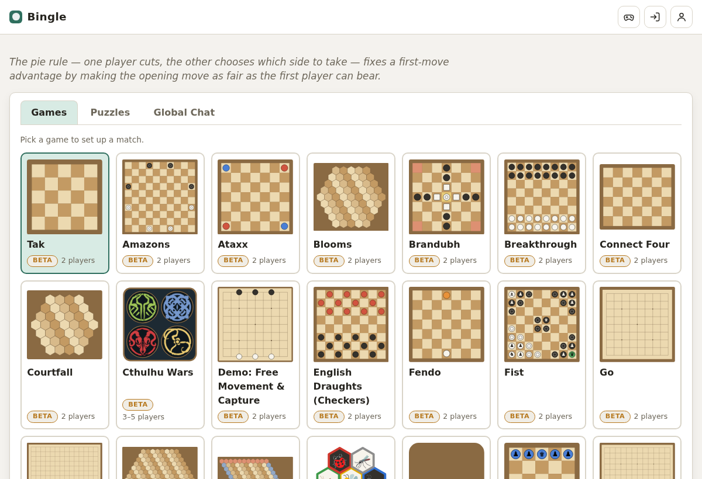
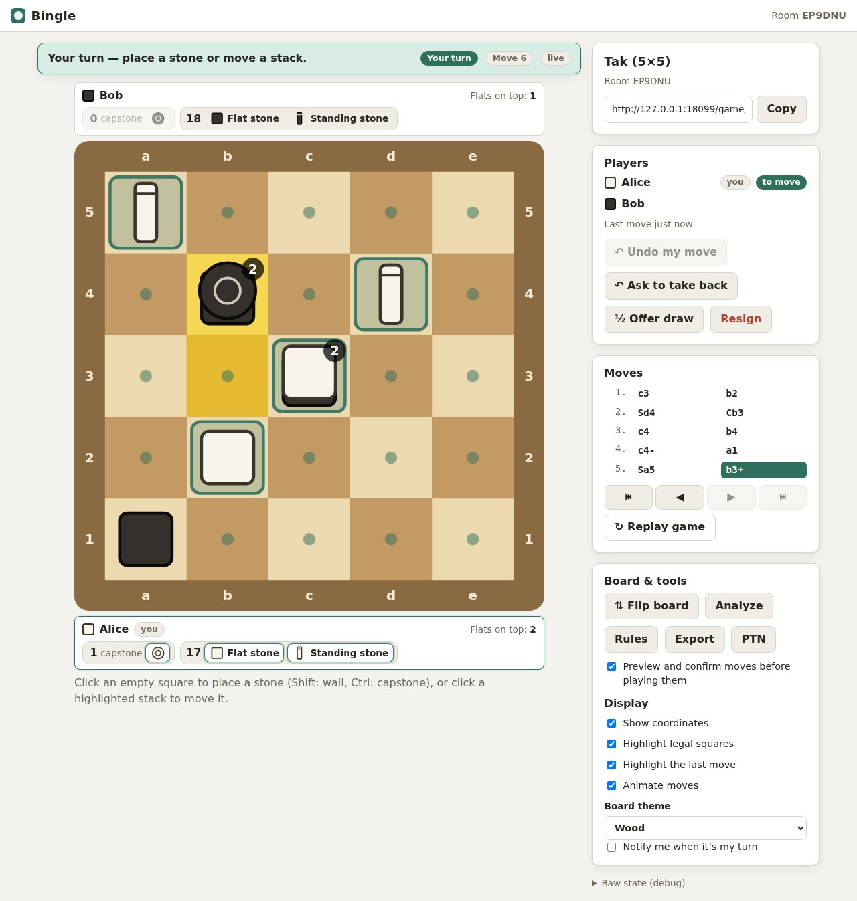
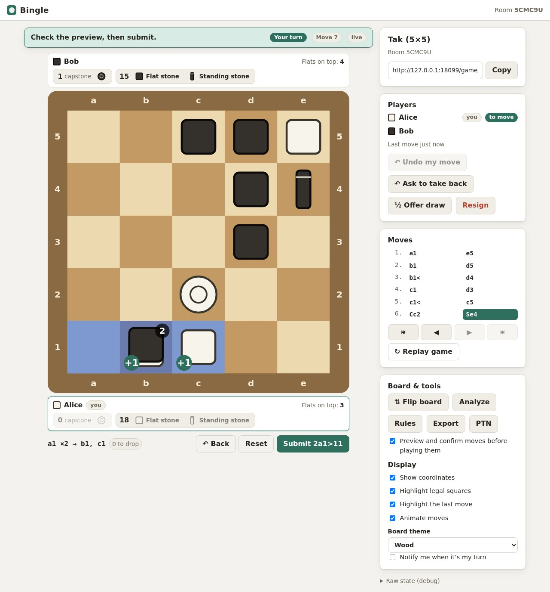
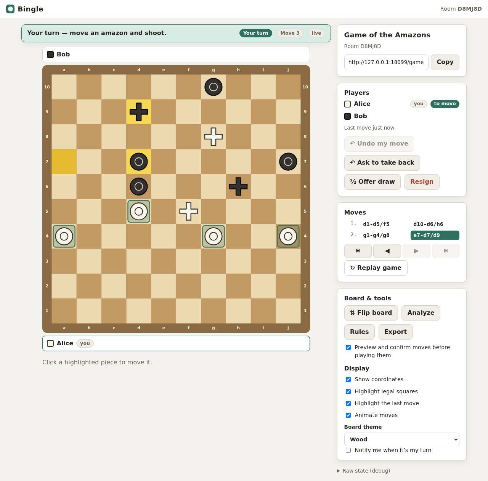
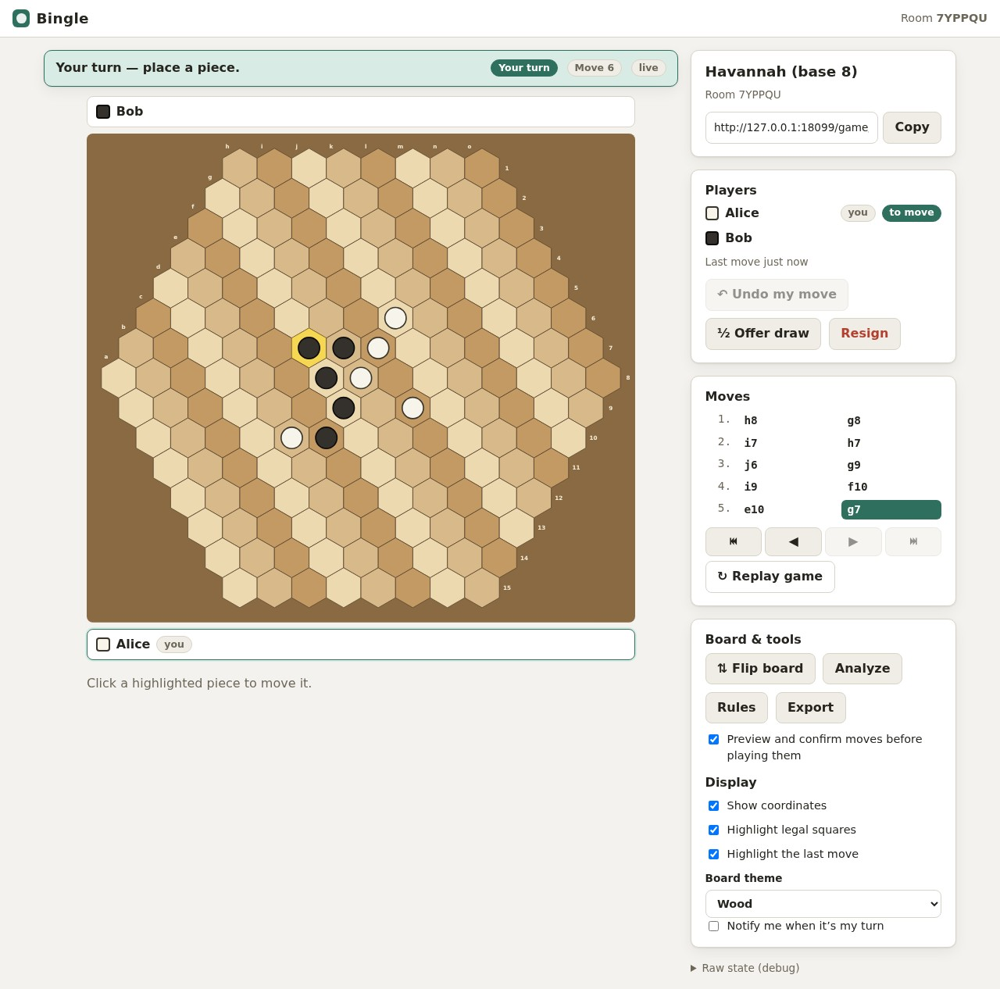
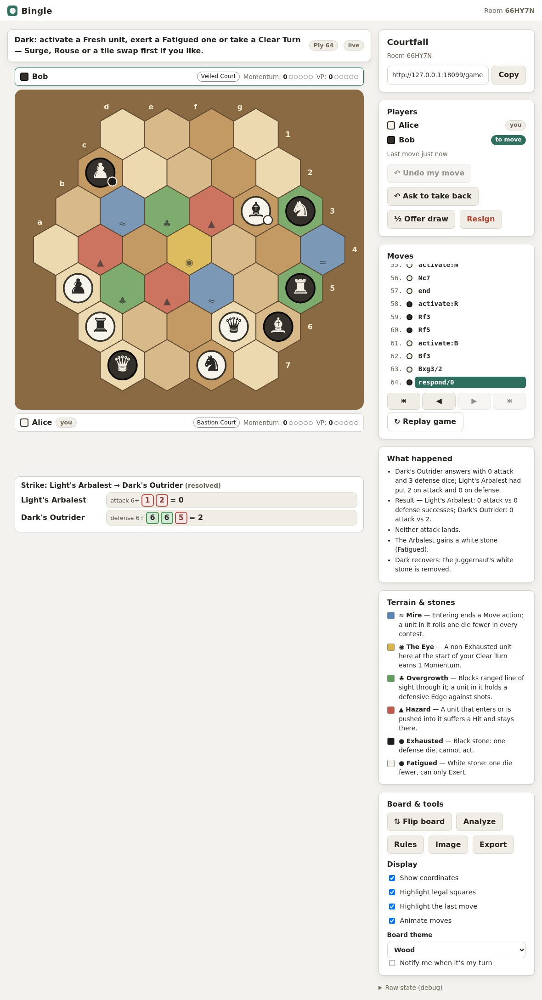
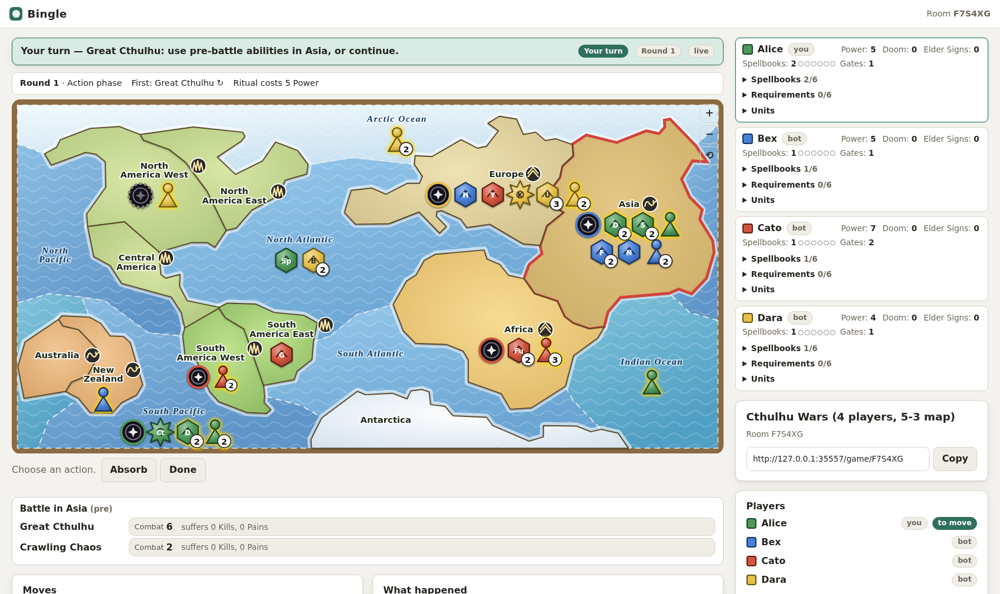
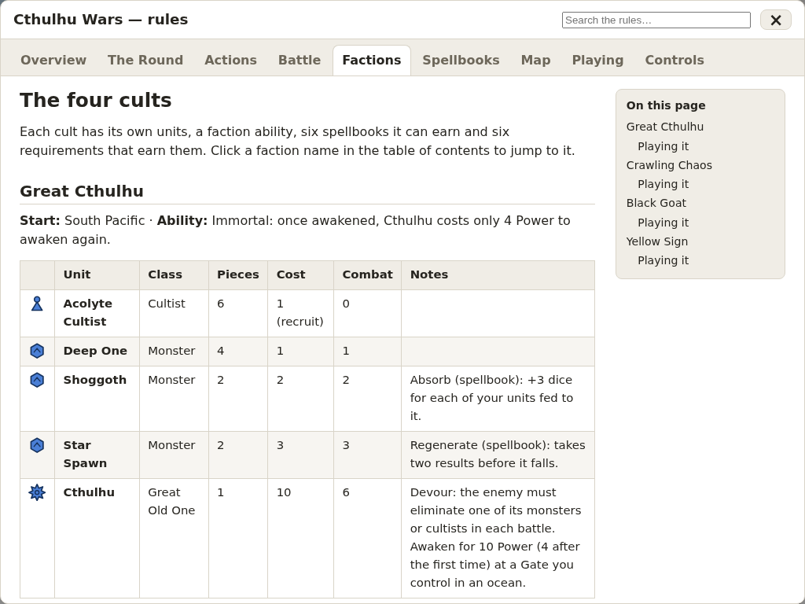

# Bingle

[](https://github.com/noderunner/bingle/actions/workflows/ci.yml)
[](LICENSE)

A small server for playing **abstract strategy games** — with friends, against
built-in bots, or as an environment for training and evaluating models. One Go
binary, an embedded SQLite database, a browser UI, a REST/WebSocket API and an
MCP server that all share one rules engine. No accounts, no external services,
no CGO: `go build` and run.

> **AI-generated code.** Most of this project, its code, tests, documentation and rules
> guides, was written by an AI assistant (Claude, by Anthropic) working with the project's
> author, who directed the design and tested the result. It has tests, but read it with that in
> mind, and review it as you would any code you did not write yourself before relying on it.
> Contributions are welcome whoever (or whatever) writes them.

> **Status: beta.** Every game is still below version 1.0 and is marked *Beta* in the
> game list. Expect rough edges and changes to the games' rules code and the API.

Games are declared in **JSON** (a board graph, pieces, actions, win rules); the
engine supplies the move generation, validation, notation and the UI supplies
click-to-move for free.

| Game | Definition |
|---|---|
| **Tak** 3×3 – 8×8 (stacks, walls, capstone, roads, PTN) | `internal/games/tak/tak.json` |
| **Courtfall** (hex arena skirmish: terrain draft, five Courts, secret dice splits, Momentum, Clear Turns — rules in Go, legend in JSON) | `internal/games/courtfall/` ([rules notes](docs/courtfall.md)) |
| **Fist** (the game from *The Verdigris Pawn*: pinning with allies, jump chains, the mage's Empower, a neutral pawn both sides can seize — rules in Go) | `internal/games/fist/` ([ADR 0036](docs/decisions/0036-fist-one-move-is-one-turn.md)) |
| **Onitama** (5×5 martial-arts duel: the sixteen Move cards, the card exchange, the Ways of the Stone and the Stream — rules in Go) | `internal/games/onitama/` ([ADR 0037](docs/decisions/0037-onitama-cards-in-the-view.md)) |
| **Blooms** (Nick Bentley's Go-like game on a hex board: two colours each, one or two stones a turn, capture fenced blooms; bases 4, 5, 6 — rules in Go) | `internal/games/blooms/` ([ADR 0038](docs/decisions/0038-blooms-two-stage-turns.md)) |
| **Hive** (John Yianni's insect tile game with the Mosquito, Ladybug and Pillbug expansions: tiles on a table, no board, Universal Hive Protocol notation; a base-game variant — rules in Go) | `internal/games/hive/` ([ADR 0039](docs/decisions/0039-hive-on-a-large-hex-field.md), [0041](docs/decisions/0041-hive-without-a-board.md)) |
| **Fendo** (Dieter Stein's territory game: move a piece and fence beside it, or add a piece; areas fenced round one piece score; 7×7, 9×9, 11×11 — rules in Go) | `internal/games/fendo/` ([ADR 0040](docs/decisions/0040-fendo-fences-in-the-view.md)) |
| **Yinsh** (Kris Burm's ring-and-marker game on an 85-point board: move rings, turn markers over, remove rows of five; blitz variant — rules in Go) | `internal/games/yinsh/` ([ADR 0042](docs/decisions/0042-yinsh-rings-and-rows.md)) |
| **Nyet!** (Stefan Dorra's trick-taking game: cross choices off a board to set the round's terms, pick teams, take tricks and loot; 2–5 players, the four classic suits, a player for each animal — the first game on the card framework) | `internal/games/nyet/`, `internal/engine/cards/` ([ADR 0043](docs/decisions/0043-card-games.md)) |
| **Cthulhu Wars** (core set with the Windwalker, Sleeper, Opener of the Way and Tcho-Tcho cults, the High Priests, the Azathoth neutral spellbooks and Monsters, the Dreamlands and Beyond Time and Space Loyalty Cards, the Hound of Tindalos and five Independent Great Old Ones, three to five players, simplified world map: Power, Gates, Doom, spellbooks, dice battles, hidden Elder Signs — rules in Go, map and rules guide as data) | `internal/games/cthulhuwars/` ([rules notes](docs/cthulhu-wars.md)) |
| Go (9×9–19×19), Reversi, Hex, Havannah, Yavalath, Amazons, Ataxx, Pente, Brandubh, English Draughts, Breakthrough, Connect Four, Gomoku, Tic-Tac-Toe | `internal/games/classics/*.json` |



| Tak, mid-game | Building a stack move (preview + confirm) |
|---|---|
|  |  |

| Amazons (move, then shoot) | Havannah (hexagon board) |
|---|---|
|  |  |

| Courtfall: terrain, conditions, Momentum and a resolved exchange (rules written in Go) |
|---|
|  |

| Cthulhu Wars: an area map, up to five cults, cult panels and the battle on the table | The tabbed rules window: tables, icons, search |
|---|---|
|  |  |

## Quick start

You need [Go](https://go.dev/dl/) (the version in `go.mod`) and `make`. Nothing else: the
dependencies are pure Go, so there is no C toolchain to install.

```sh
git clone https://github.com/noderunner/bingle.git
cd bingle
make build && ./bin/bingle           # http://localhost:8080
```

Or without cloning: `go install github.com/noderunner/bingle@latest`, then run `bingle`.

Open the lobby, pick a game, choose a friend or a bot, and play. Share the
game link to invite someone; they join with a name (no accounts).

With a container: `podman build -f Containerfile -t bingle . && podman run --rm -p 8080:8080 -v bingle-data:/data bingle`
(or `docker`). See [docs/build.md](docs/build.md).

Configuration is by environment variable — see [docs/build.md](docs/build.md)
(`BINGLE_ADDR`, `BINGLE_DB_PATH`, `BINGLE_TLS_CERT`/`KEY`,
`BINGLE_RETENTION_DAYS`, `BINGLE_PUBLIC_URL` for invite links). HTTPS is
optional: plain HTTP by default, or automatic Let's Encrypt certificates with
`BINGLE_TLS_DOMAIN` — see [docs/tls.md](docs/tls.md). Players can talk in a game with the
built-in voice chat (needs HTTPS or localhost) — see [docs/voice.md](docs/voice.md). Optional
email notifications ("it is your turn") are set up with an SMTP server — see
[docs/email.md](docs/email.md). [scripts/run.example.sh](scripts/run.example.sh) shows a
complete setup.

> **Security model.** Bingle has no accounts: a seat belongs to whoever uses its name in that
> game, and anyone who knows a game's link can join or watch. It suits a group of friends, not
> an open public service. Read [SECURITY.md](SECURITY.md) before exposing it.

## Repository layout

```
main.go                   the server's entry point
internal/
  engine/                 the rules machinery: dsl (the JSON format), catalog (compiles a
                          definition), board, primitives, state (positions, moves, rulesets), cards
  games/<name>/           one package per game: its JSON definition, Go rules where it needs
                          them, and its rules guide (Markdown + SVG)
  session/                games as the rest of the system sees them: create, join, move, undo,
                          bots, reactions, chat, voice, notifications
  store/                  the SQLite database
  api/  mcpserver/  web/  the REST + WebSocket API, the MCP server, the browser UI (static files);
  wire/                   the JSON shapes the first two share
  bots/  envs/  batch/  puzzles/  the built-in bots, training environments, practice batches, puzzles
tests/                    black-box tests, one folder per package (tests/app drives a real browser)
scripts/                  helper programs: docs and puzzle generators, a Python Gym client, diagrams
docs/                     the manual; docs/decisions has an ADR for each big decision
```

## What's in the box

* **Web UI** — game gallery and *your turn* flags; click-to-move for every game
  (including multi-square Tak stack moves and Amazons' slide-and-shoot) with
  preview-and-confirm; coordinates, stacks, reserves, last-move and
  legal-target highlighting; move animations; keyboard play (arrow keys,
  Enter); move list with history navigation and replay; undo, take-back
  requests, draw offers, resign; per-move clocks; analysis board with move
  import and *Play from here*; bot hints; puzzles; game import; watch-the-bots
  rooms; PTN/JSON/SVG export;
  light/dark; live updates and notifications. ([docs/ui.md](docs/ui.md))
* **Rules window** — every game's rules in tabs with tables, callouts,
  inline piece icons and images, a table of contents and search; games ship
  Markdown pages, others get a generated guide. ([ADR 0026](docs/decisions/0026-area-maps-and-rules-guides.md))
* **Area maps and many seats** — irregular maps drawn from straight-edged
  polygons, clickable unit tokens, a *Play as* choice and bots for empty seats
  (Cthulhu Wars). ([docs/cthulhu-wars.md](docs/cthulhu-wars.md))
* **Setup options** — a game can offer choices at creation (which cult sits
  where, an expansion); each table is a game of its own derived from the
  definition. ([ADR 0028](docs/decisions/0028-derived-games-and-setup-options.md))
* **Go rulesets** — games with dice, hidden choices or per-unit state
  (Courtfall, Cthulhu Wars) implement `state.Ruleset` in Go behind the same API: public
  and private views of a position, seeded chance, determinized search bots
  and no undo across a die roll. ([ADR 0025](docs/decisions/0025-go-rulesets-and-hidden-information.md))
* **Engine** — stacking, placement from reserves, multi-square stack moves,
  jumps with chains, slides with follow-up shots, clone-or-jump leaps, flips,
  liberty captures with ko, opening rules, declarative connect / line / ring /
  reach / end win rules, variants, move notation (PTN for Tak) and TPS
  positions, custom start positions. ([docs/dsl.md](docs/dsl.md))
* **Bots** — random, tactical, minimax (alpha-beta) and Monte-Carlo tree
  search, for any game.
* **API** — REST + WebSocket for custom clients (`/api`, `/ws/{code}`).
  ([docs/api.md](docs/api.md))
* **MCP** — rooms for agents, plus gym-style in-memory environments
  (`env_reset` / `env_step` / `env_fork` / `env_batch_step`) for training, with
  numeric board planes, fixed action IDs, proven puzzles, bot matches and
  recorded training positions. ([docs/mcp.md](docs/mcp.md))

## Adding a game

Write a JSON document (start from `classics/tictactoe.json` — about 40 lines),
embed it in a package with `catalog.Module`, and register it in
`internal/app/app.go`. See [docs/dsl.md](docs/dsl.md). Rules JSON can't
express go in a Go ruleset (`"engine": "ruleset"`, ADR 0025 — Courtfall and Cthulhu Wars)
or a new engine action type (ADR 0022 describes how `slide` and `leap` were
added).

## Development

```sh
make build     # bin/bingle
make test      # go test ./...  (about 6 minutes: it includes browser-driven UI tests)
make test-short  # under a minute: skips the browser tests and the slowest simulations
make lint      # gofmt + golangci-lint
make cover     # a coverage report
```

The browser tests need Chrome or Chromium on your `PATH` (or `BINGLE_BROWSER=/path/to/it`);
without one they are skipped and everything else still runs. See [docs/test.md](docs/test.md).
More helpers: `go run scripts/genpuzzles/main.go` (the proven puzzle set),
`go run scripts/gendocs/main.go > docs/games.md` (the game catalog),
`python3 scripts/guide_diagrams.py` (the diagrams in the rules guides).

Contributions are welcome: see [CONTRIBUTING.md](CONTRIBUTING.md) — adding a game, fixing a bug,
improving a rules page. Each game carries a version in its JSON (`version`): raise it when you
change the game. The engine has a version of its own in `internal/version`.

Docs: [architecture](docs/architecture.md) · [roadmap & status](docs/roadmap.md) ·
[game catalog](docs/games.md) · [decisions](docs/decisions/README.md) ·
[testing](docs/test.md) · [building](docs/build.md) · [history](docs/history/README.md).

## License and credits

Bingle is released under the [MIT License](LICENSE).

The games are independent implementations of published rules. Their names, art and designs belong
to their designers and publishers, who are credited in each game's information (`designers` and
`publisher` in its JSON) and are not affiliated with this project. In particular, Cthulhu Wars is a
product of Petersen Games; this is an unofficial fan implementation for private play, and its
sigil drawings and map layouts were traced or drawn from pictures on the Cthulhu Wars wiki and
other fan sites. If you are a rights holder and would like something changed or removed, please
open an issue. Courtfall was designed by the project's author; its rulebook is in
[docs/courtfall-rulebook.md](docs/courtfall-rulebook.md).
