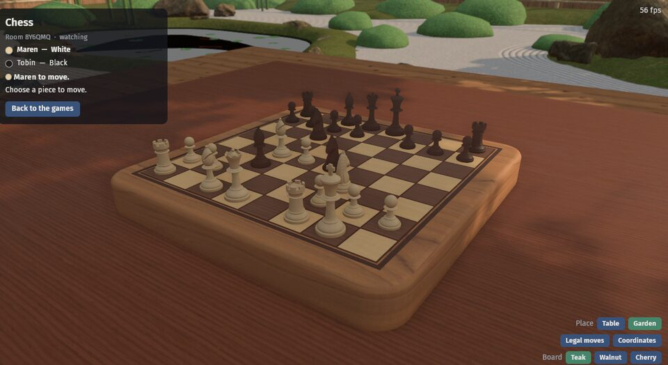
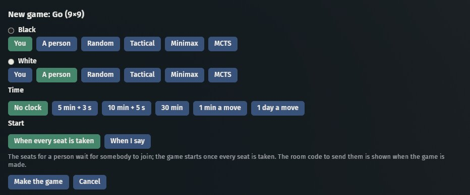
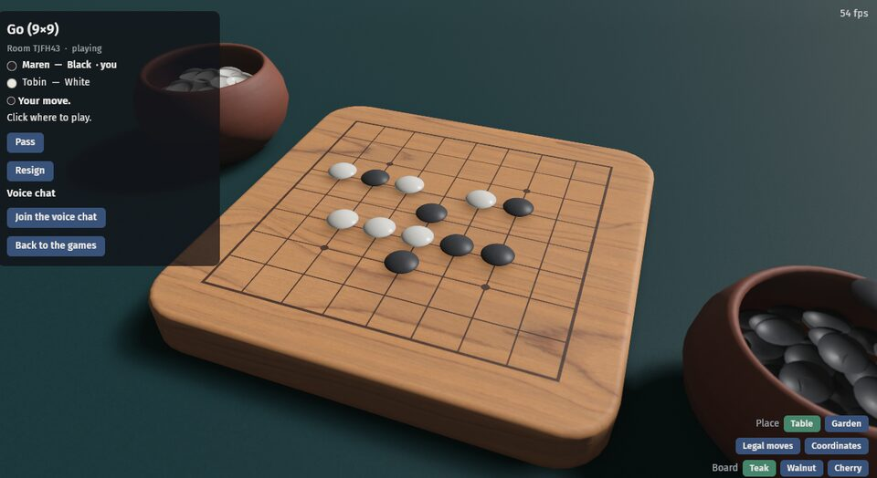
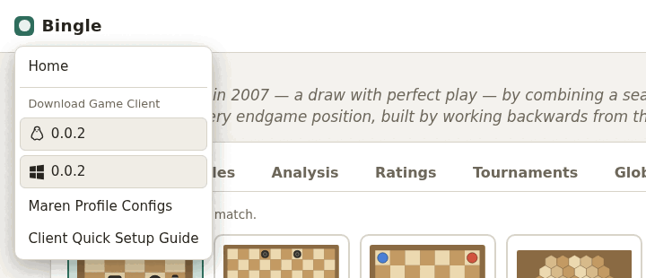

# The 3D game client is here

Play this server's games in 3D on Windows or Linux, or in VR when SteamVR is running.

---

## Along the way

---

## Where to get it

Click the logo, then the button for your system.

---

## Your profile configs

In the same menu, **Profile Configs** with your name makes a file that connects the client to this server as you. Put it beside the program before you start it.

[Client Quick Setup Guide](/client)
