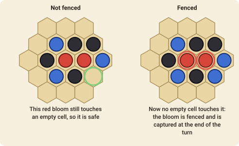

# Blooms

Blooms is a Go-like game by Nick Bentley played on a hexagonal board with **four colours of stone**. You win by capturing your opponent's *blooms*, which are groups of one colour that you have fenced in.

## The goal

Be the first player to **capture enough enemy stones**. The target depends on the board: **15** stones on the small board (4 cells to a side), **20** on the standard board (5 to a side) and **25** on the large board (6 to a side).

## The stones

Each player has **two colours** of stone, and a stone's colour matters: stones only join up with others of the same colour.

- Player 1 has **red** and **yellow** stones.
- Player 2 has **blue** and **black** stones.

A **bloom** is a connected group of stones of one colour (a single stone is a bloom too). Two stones are connected when they touch along an edge of the hexagons. A red stone touching a yellow stone is two separate blooms.

## A turn

- Player 1 starts the game with **one** stone of either of their colours.
- After that, on your turn you place **one or two stones** on empty cells. If you place two they must be of **different colours** (one of each of your colours). You may place just one if you like.

### The pie rule

The player who moves first has an advantage, so a table may play with the **pie rule** (tick
*Pie rule* when the game is made). Instead of answering the opening stone, the second player
may **swap sides**: the players change seats — the stone stays exactly where and what it is —
and the first player moves again, answering their own opening from the other side. It is
then in the first player's interest to open with a stone that is neither too strong nor too weak.
The move is `swap`.

## Capturing

A bloom is **fenced** when **no empty cell touches any of its stones**: every neighbouring cell is filled (with stones of any colour) or is off the edge of the board.

At the **end of your turn**, you capture every **enemy bloom that is fenced**: it is removed from the board and you count the stones you took.

Your own fenced blooms are *not* captured on your turn. They stay on the board until the end of your opponent's turn, so you get a chance to **free** a bloom of yours that has been fenced in, for example by capturing an enemy bloom that was part of the fence, which leaves empty cells next to it.

Sacrificing a few stones to fence in a bigger bloom is the heart of the game.

## The end of the game

The first player to reach the target number of captured stones **wins**. If the game reaches 500 plies (turns of one player), the player with more captured stones wins, and equal counts are a draw.

## Move notation

A stone is its colour, `@` and a cell: `red@d4`. Player 1 has red and yellow, player 2 blue and black. A turn is one stone or two stones of different colours (the second is a separate move); `done` ends the turn after one. With the pie rule, `swap` is the second player's possible first reply.
