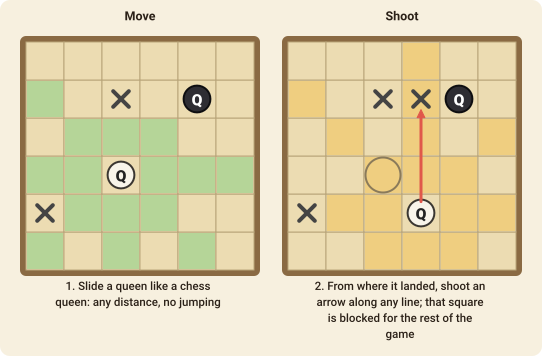

# Amazons

Amazons is a game of walls. Every turn you move a queen and then shoot an arrow that burns a square for good, until one side has no moves left.

## The goal

You win when your opponent **cannot move any of their queens**. There are no draws: the board eventually fills with arrows.

## The pieces

Each player has **four queens** (called Amazons) at the start of the game, on a 10×10 board. (The 6×6 variant has two.) White moves first.

## A turn: move, then shoot

Every turn has **two parts**, and you must do both:

1. **Move.** Slide one of your queens like a queen in chess: in a straight line in any of the eight directions (along a row, a column or a diagonal), any distance, over empty squares. It may not jump over anything or land on anything.
2. **Shoot.** From the square where the queen landed, shoot an **arrow** along any straight line in the same way, onto an empty square. The arrow stays on that square for the rest of the game.

Arrows are barriers for **both** players: no queen or arrow can land on an arrow, and nothing can pass over one. The square the queen just left is empty, so an arrow may be shot back through it, or onto it.

The first player who has **no legal move** at the start of their turn loses.

## Playing it

The game starts as a race to claim space. As the arrows build up, the board splits into separate regions, and what matters is **how many squares each side's queens can still reach in their own regions**. A queen stuck in a small pocket is a wasted queen, so you try to wall your opponent into small areas while keeping the large ones for yourself.

## Move notation

A move is `from-to/arrow`: the queen's square, the square it moves to and the square the arrow lands on, for example `d1-d5/f5`. Columns are `a`–`j` and rows `1`–`10` from the bottom.
