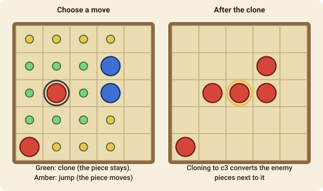

# Ataxx

Ataxx is a game of growth and infection. Every move can add to your colony and turn your opponent's pieces into yours.

## The goal

When the board is full, or when neither player can move, **the player with more pieces on the board wins**. If the counts are equal, the game is a draw.

## The setup

The board is 7×7. Each player starts with two pieces in opposite corners (Red in the bottom-left and top-right, Blue in the other two). Red moves first.

## A move

On your turn, move **one of your pieces to an empty square at most two squares away**, counting diagonals:

- **Clone**: to a square **one** step away (in any of eight directions). The original piece stays, so you end with one more piece.
- **Jump**: to a square **two** steps away. The piece moves, so you end with the same number of pieces.

Then every **enemy piece next to the square where you landed** (in all eight directions) is **converted** to your colour.

If you have no legal move, you **pass**. The game ends when the board is full or when neither player can move.

## Playing it

Cloning is how you grow, so most of the game is cloning; a jump is for reaching a hole you can't clone into, but it leaves a hole behind that your opponent can fill. Look out for empty squares in the middle of your own pieces: an opponent who lands there will convert many of them at once.

## Move notation

A move is `from-to`, for example `g7-e7`. Columns are `a`–`g` and rows `1`–`7`.
