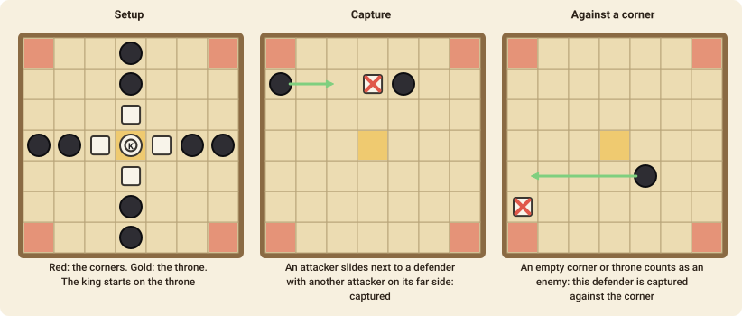

# Brandubh

Brandubh is an Irish member of the *tafl* family of hunt games, played for more than a thousand years. The two sides are not equal: a small group defends a king, and a larger one hunts him.

## The goal

- The **defenders** (white) win if their **king reaches one of the four corner squares**.
- The **attackers** (black) win by **capturing the king**.
- A player who has **no legal move** loses.

## The setup

The board is 7×7. The king stands on the central **throne**, with four defenders next to him. Eight attackers stand in pairs at the middle of each side. The four **corners** and the throne are special squares. The attackers move first.

## Moving

Every piece, including the king, moves like a **rook** in chess: any number of squares in a straight line, along a row or a column, over empty squares. No piece may jump over another.

Only the **king** may stop on a corner or on the throne. Other pieces may pass **over** the empty throne, but not land on it.

## Capturing

You capture an enemy piece by **sandwiching** it along a row or a column between two of your pieces. You must make the move that completes the sandwich yourself:

- The captured piece is removed.
- A piece that moves **between** two enemies is safe.
- An **empty corner**, or the **empty throne**, counts as an enemy to the attackers and the defenders alike: a piece can be captured against it.
- The **king** is captured like any other piece.

## Playing it

The attackers try to **seal the corners** by placing pieces so the king can't get through to them, while the defenders open lines for the king and make two corner threats at once. A king that reaches a position where he threatens two corners at the same time cannot be stopped.

## Move notation

A move is `from-to`, such as `d7-e7`. Columns are `a`–`g` and rows `1`–`7`.
