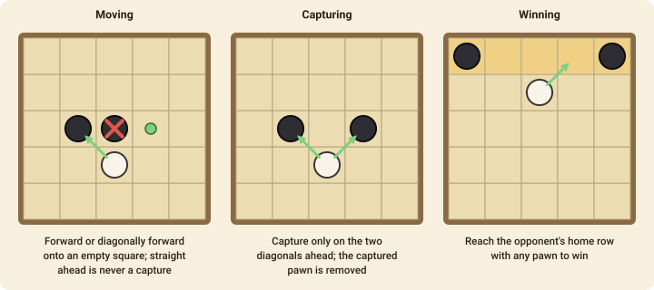

# Breakthrough

A race and a battle at once: each side tries to get a single pawn through to the other side's home row. It has very few rules and a lot of tension.

## The goal

You win by moving one of your pawns onto the **opponent's home row** (the far edge of the board). You also win if your opponent has no pieces or no legal move.

## The setup

The board is 8×8. Each player starts with **16 pawns** filling their two home rows. White moves first.

## Moving and capturing

On your turn you move **one pawn one square** in a forward direction:

- **straight ahead** onto an empty square, or
- **diagonally ahead** onto an empty square, or
- **diagonally ahead** onto a square that holds an enemy pawn: you **capture** it, and your pawn takes its place.

You can *never* capture straight ahead: an enemy pawn directly in front of you simply blocks the way. Pawns never move sideways or backwards, and capturing is optional.

Because everyone has so many pawns, defence matters as much as offence: a pawn that has no friends behind it is easy to take, and a lone attacker that gets within two squares of the goal often cannot be stopped.

## Move notation

A move is `from-to` for a step and `from-to` for a capture too, such as `d2-d3` or `e7-f6`.
