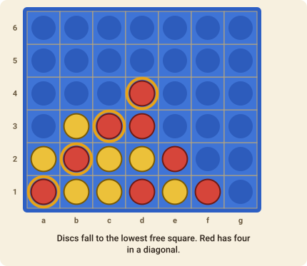

# Connect Four

Drop discs into a standing grid and be the first to line up four of your own.

## The goal

Make a line of **four of your discs** in a row, a column or a diagonal before your opponent does.

## How to play

1. The board is a grid of **seven columns and six rows**, and it stands upright. Red goes first and the players alternate.
2. On your turn, choose a column that is not yet full and **drop a disc into it**. The disc falls to the lowest empty square of that column.
3. Discs never move and are never removed.
4. The first player to get **four discs in an unbroken line** wins: horizontally, vertically or diagonally.
5. If all 42 squares fill up with no line of four, the game is a **draw**.

Because discs fall, the squares just above a column's top disc are the only ones you can play. That makes threats you can't see on a flat board: a line that needs an empty square which is *not yet playable* will become playable only after someone fills the square below it.

### The pie rule

The player who moves first has an advantage, so a table may play with the **pie rule** (tick
*Pie rule* when the game is made). Instead of answering the opening move, the second player
may **swap sides** on their first turn: every piece on the board changes hands and the first player
moves again. It is then in the first player's interest to open with a move that is neither too
strong nor too weak. The move is `swap`.

## Move notation

A move names the square the disc lands on, such as `d1` (the bottom of the fourth column). Columns are the letters `a`–`g` from left to right, rows the numbers `1`–`6` from the bottom. In the game you simply click the column.
