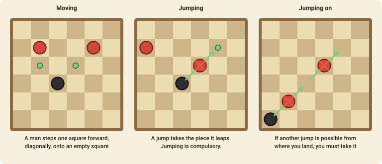

# English Draughts (Checkers)

A game of diagonal steps and compulsory jumps on an 8×8 board. This is the English version, which is called **checkers** in the United States.

## The goal

You win when your opponent **cannot move**: when all their pieces have been captured, or when the ones they have left are all blocked. If the game goes on for 200 moves (plies) with no winner it is a draw.

## The pieces and the board

Each side starts with **12 men** on the dark squares of the three nearest rows. Black moves first and plays towards the top of the board; Red plays towards the bottom. All the play is on the dark squares.

A man that reaches the far row is **crowned**: it becomes a **king**, drawn with a ring.

## Moving

- A **man** moves one square **diagonally forward** onto an empty square.
- A **king** moves one square diagonally in **any** of the four directions, forward or backward.

## Jumping (capturing)

- To capture, **jump** diagonally over an adjacent enemy piece onto the empty square just behind it. The jumped piece is removed.
- A man jumps **forward** only. A king can jump in any of the four diagonal directions.
- **Jumping is compulsory.** If you can jump, you must. If you have several jumps to choose from, you may pick any of them.
- If, after a jump, the same piece can jump again, it **must keep jumping** in the same move. It can change direction between jumps.
- If a man reaches the far row in the course of a jump, it is crowned and **its move ends there**, even if a king could have jumped on.

## Move notation

- A step is `from-to`, for example `c3-d4`.
- A jump is `fromxlanding`, and a chain of jumps lists every landing square: `a1xc3xe5`.
