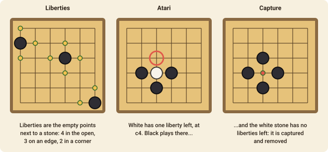
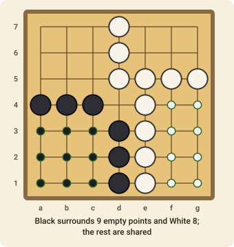

# Go

Go is the oldest board game still played in its original form, and one of the deepest. The rules are tiny: you place stones to surround space and to capture your opponent's stones. This page covers the 9×9 board, with the 13×13 and 19×19 boards played the same way.

## The goal

Control more of the board than your opponent. When the game ends, each player scores **the stones they have on the board plus the empty points that only their stones surround**. White also gets a **komi** of 6.5 points, to make up for Black having the first move. The higher score wins, and because of the half point there are no ties.

## The board and the stones

Go is played on the **intersections** of the lines (not in the squares). One player has black stones, the other white. **Black moves first**, and you alternate placing one stone on an empty intersection. Stones are never moved after they have been placed, and can only leave the board by being captured.

## Liberties and capture

Stones next to each other along a line (not diagonally) form a **group**, which lives or dies together. The **liberties** of a group are the empty intersections next to any of its stones: four for a stone in the open, three on an edge, two in a corner.

When a group has **no liberties left**, it is **captured** and removed from the board. You capture by playing a stone on the last liberty of an enemy group. A group with a single liberty left is said to be in **atari**.

## Two restrictions

- **No suicide.** You may not play a stone that leaves its own group without liberties, unless the stone captures something (the capture gives the group a liberty back).
- **Ko.** You may not play a move that brings the board back to exactly the position it was in just before your opponent's last move. That rules out the endless back-and-forth when two players can keep capturing the same single stone. You have to play elsewhere first.

## Passing and the end of the game

On your turn you may **pass** instead of placing a stone. When both players pass **one after the other**, the game ends and is scored.

The score is counted by **area**: a player's score is the number of their stones on the board plus the number of empty points in regions surrounded **only by their stones**. Empty points that touch both colours count for nobody.

**Dead stones are not removed automatically.** Before you pass, capture any enemy stones that are certain to die: the game scores the board as it stands.

## Move notation

A move names the intersection, such as `e5` (the middle of the 9×9 board). Columns are letters from `a` on the left and rows are numbers from `1` at the bottom (a 19×19 board runs `a`–`s`). A pass is written `pass`.
