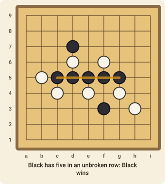

# Gomoku

Gomoku ("five in a row") is played with Go stones on the lines of a Go board. Placing stones is all there is to it, and there is plenty of tactics in the placing.

## The goal

Be the first to make an **unbroken row of five (or more) stones** of your own colour, in a line that is horizontal, vertical or diagonal.

## How to play

1. The board is a grid of lines, **15 × 15** intersections. Stones are placed **on the intersections**, not in the squares.
2. **Black** moves first, then White, alternately. On your turn place one stone on any empty intersection.
3. Stones never move and are never captured.
4. The first player to line up **five or more** of their stones in a row wins. A row of six or seven also wins.
5. If the board fills up with no five in a row, the game is a draw.

### The swap

Moving first is a big advantage. To balance it, White has one special option on their first turn: instead of placing a stone, White may **swap** sides. Black's stone then becomes White's, and Black moves next. A first move that is too strong gets swapped, so Black is encouraged to choose a modest one.

## Strategy

The key shapes are the **open three** (three in a row with room at both ends) and the **four** (four in a row with an empty end). A four must be blocked at once, and a player who makes two threats at the same time, such as a four and an open three, cannot be stopped.

## Move notation

A move names the intersection: `h8` is the middle of the board. Columns run `a`–`o` from left to right and rows `1`–`15` from the bottom. To swap, the move is `swap`.
