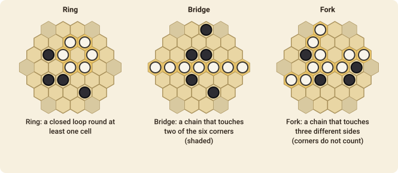

# Havannah

Havannah is a connection game on a hexagonal board with **three different ways to win**. They are all about making one connected group of your pieces.

## The goal

You win by making any one of these shapes out of your own pieces:

- a **ring**: a closed loop of your pieces round at least one cell (that cell can be empty or hold any piece);
- a **bridge**: a connected group touching **two of the six corners** of the board;
- a **fork**: a connected group touching **three different sides** of the board (the corner cells don't count as part of a side).

## How to play

1. The board is a hexagon of hexagonal cells. The game here is played on a base of **8** cells to a side, with 4, 6 and 10 as other sizes. White goes first and the players alternate.
2. On your turn, place **one piece** of your colour on any empty cell.
3. Pieces never move and are never removed.
4. The first player to complete a ring, a bridge or a fork wins, even if the same move completes more than one of them.
5. If the board fills up with no winner, the game is a draw.

## Playing it

The three goals pull in different directions. A ring is made in the middle of the board and is the hardest to see coming; a bridge or a fork needs the edges. Players often make threats of one kind to force their opponent to answer, while building up a second. A piece placed next to the edge can often be an anchor for both a fork and a bridge.

## Move notation

A move names the cell, such as `h8`. Columns are letters and rows are numbers, shown when you turn on the coordinates.
