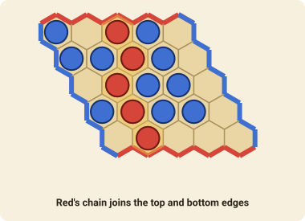

# Hex

Hex is a pure connection game on a board of hexagons: two players race to link their own two sides. One of you will always manage it, because **the game cannot end in a draw**.

## The goal

Red owns the **top and bottom** sides of the board and wins by making a chain of red stones that joins them. Blue owns the **left and right** sides and wins by joining those. A chain is a line of stones where each touches the next, along an edge of the hexagons.

## How to play

1. Red goes first, then Blue, alternately.
2. On your turn place **one stone** of your colour on any empty hexagon.
3. Stones never move and are never removed.
4. The first player whose stones connect their two sides wins.

The corner hexagons belong to both neighbouring sides. Each hexagon touches six others, so every chain has to be built with care: to stop Red, Blue has to build a wall of his own.

### The swap

The first player has a big advantage, so the second player may **swap** on their first turn. Instead of placing a stone, Blue takes over the first stone: it changes colour to Blue's and Red moves next. To make this fair, Red should open with a move that is neither too strong nor too weak.

This is the **pie rule**, and Hex is played with it here unless the table unticks *Pie rule* when the game is made.

## Move notation

A move names the hexagon, such as `f6`. Columns are letters from `a`, rows are numbers from `1`. To swap, the move is `swap`.
