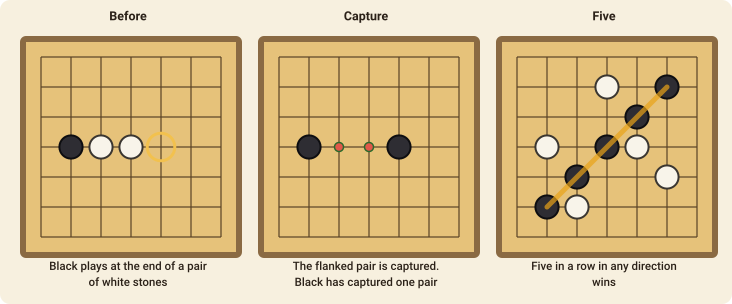

# Pente

Pente is five-in-a-row with captures: it adds a way to win by taking stones, and a way to lose the stones you've built.

## The goal

You win by either:

- making **five or more** of your stones in an unbroken row (horizontally, vertically or diagonally), or
- **capturing five pairs** (ten stones) of your opponent's.

## How to play

1. The board is a 13×13 grid of lines. Stones go on the **intersections**. Black moves first and the players alternate, placing one stone on any empty intersection.
2. Stones don't move once they are placed. They only leave the board by being captured.
3. If the board fills with no winner, the game is a draw.

## Capturing

You capture when you place a stone so that **exactly two** adjacent enemy stones in a straight line (a *pair*) have one of your stones at each end. Both stones are removed from the board, and the two empty points can be played again.

- It must be exactly **two** stones: three in a row between your stones is not captured.
- It has to be **you** who completes the sandwich. A stone that moves between two enemy stones is **safe**: placing your own stone into a gap between two enemies doesn't hurt it.
- Captures work in all eight directions. One stone can capture several pairs at once.

Captured pairs are counted for each player, and the player who takes their **fifth** pair wins at once.

## Playing it

Because every stone you play can be part of a pair, your own threats have to avoid making pairs that can be flanked. A row of two is a weakness; a row of three (or more) can't be captured as a pair, which is why players try to build lines of three.

### The pie rule

The player who moves first has an advantage, so a table may play with the **pie rule** (tick
*Pie rule* when the game is made). Instead of answering the opening move, the second player
may **swap sides** on their first turn: every piece on the board changes hands and the first player
moves again. It is then in the first player's interest to open with a move that is neither too
strong nor too weak. The move is `swap`.

## Move notation

A move names the intersection: `g7` is the middle of the board. Columns are `a`–`m` and rows `1`–`13`.
