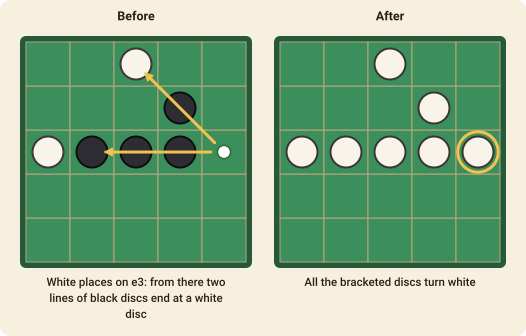

# Reversi (Othello)

Reversi is a game of flipping: every disc you place can turn many of your opponent's discs into yours, and a lead can change hands in a single move.

## The goal

When the game ends, the player with **more discs of their colour** on the board wins.

## The setup

The board is 8×8. The game starts with four discs in the middle, two of each colour, on the diagonals. **Black** moves first, then White, alternately.

## Placing and flipping

On your turn you place a disc of your colour on an empty square, and the placement must **bracket** at least one line of enemy discs:

- Starting from the new disc, look along any of the **eight directions**: left, right, up, down and the four diagonals.
- If a straight, unbroken run of **one or more enemy discs** lies next to the new disc and is closed off at the other end by one of **your own** discs, those enemy discs are bracketed.
- All the bracketed discs, in every direction at once, are **flipped** to your colour.

If you have no square where you can bracket a line, you **pass**. If you can place a disc, you must.

## The end of the game

The game ends when **neither player can move**. This is usually when the board is full, but it can happen earlier. The player with more discs wins; if the counts are equal, the game is a draw.

## Strategy in a sentence

The discs in the corners can never be flipped, so the corners and the edges that lead out of them are worth far more than having many discs early in the game.

### The pie rule

The player who moves first has an advantage, so a table may play with the **pie rule** (tick
*Pie rule* when the game is made). Instead of answering the opening move, the second player
may **swap sides** on their first turn: the players change seats — nothing on the board moves
or changes colour — and the first player answers their own opening from the other side. It is then in the first player's interest to open with a move that is neither too
strong nor too weak. The move is `swap`.

## Move notation

A move names the square the disc is placed on, such as `d3`. Columns are `a`–`h` and rows `1`–`8`.
