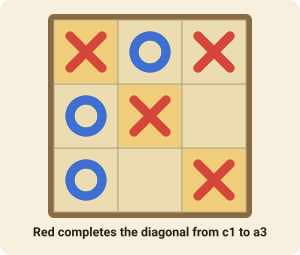

# Tic-Tac-Toe

The classic pencil-and-paper game on a 3×3 grid. It is very easy to learn, and a good way to try out the board.

## The goal

Get **three of your marks in a row** before your opponent does. The row can be horizontal, vertical or diagonal.

## How to play

1. Red (X) goes first. The players take turns placing one of their marks on any **empty** square.
2. Marks never move and are never removed.
3. The first player to line up three of their own marks **wins** at once.
4. If all nine squares are full and nobody has three in a row, the game is a **draw**.

Played perfectly by both sides, the game is always a draw. If your opponent makes a mistake, such as leaving two in a row unblocked, you can win.

## Move notation

To place a mark, give the square: `a3` is the top-left square, `c1` the bottom-right. The columns are `a`–`c` from left to right and the rows `1`–`3` from the bottom up.
