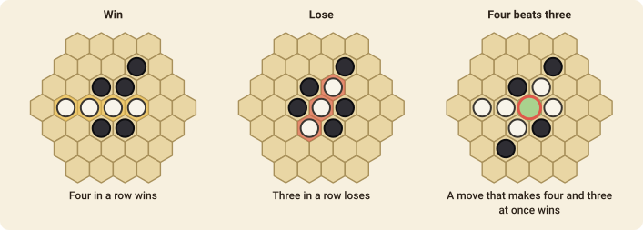

# Yavalath

Yavalath was designed by a computer program, and has a twist found in few other games: it is a race to four in a row, but **making three in a row loses**.

## The goal

You **win** by making a line of **four or more** of your pieces. You **lose** if you make a line of exactly **three** of your pieces, unless that move also makes a line of four.

## How to play

1. The board is a hexagon of hexagonal cells, **five cells to a side**. White goes first and the players alternate.
2. On your turn, place **one piece** of your colour on any empty cell.
3. Pieces never move and are never removed.
4. A **line** is pieces of one colour that touch one after another along a straight line of cells, in any of the board's three directions.
5. A player who makes a line of four wins. A player who makes a line of three (and not four with the same piece) **loses** immediately.
6. If the board fills up with neither, the game is a draw.

A line of four **beats** a line of three made by the same move, as in the right-hand picture: placing the piece that completes four wins even though it also makes a line of three.

## Playing it

You almost never want to make three in a row, so the first thing to learn is to look at every empty cell and ask what it would do for *you*. A cell where you would lose is a cell your opponent can use against you: they can leave it for you to be forced to fill. The surest way to win is to make a **double threat** of four, which cannot be stopped.

### The pie rule

The player who moves first has an advantage, so a table may play with the **pie rule** (tick
*Pie rule* when the game is made). Instead of answering the opening move, the second player
may **swap sides** on their first turn: every piece on the board changes hands and the first player
moves again. It is then in the first player's interest to open with a move that is neither too
strong nor too weak. The move is `swap`.

## Move notation

A move names the cell, such as `e5`. The columns are letters and the rows numbers, as shown on the board when you turn on the coordinates.
