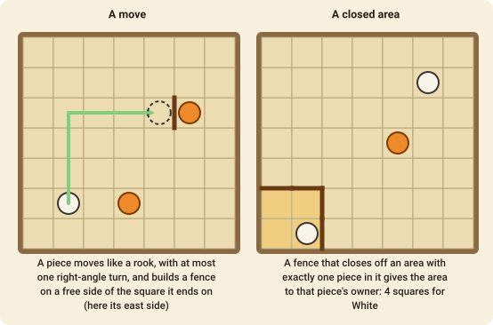

# Fendo

Fendo is a territory game by Dieter Stein. You move pieces and build **fences** until the board is divided into closed areas, each belonging to the single piece inside it. The player who owns more squares wins.

## The goal

The game ends when the last open space has been closed off by fences. Every area then holds exactly one piece and **belongs to that piece's owner**. Each player counts the squares in the areas they own, and the **larger total wins**. Pieces still in your stock count for nothing.

## The setup

The board is a grid of **7×7** squares (9×9 and 11×11 are also played). The outer edge of the board is already a wall. Each player has **7 pieces**: one stands on the middle square of their own side, and the other six wait in their **stock**. White moves first.

## A turn

On your turn you do **one** of two things:

### 1. Move a piece and build a fence

Choose one of your pieces, **optionally move it**, and then **build a fence** on one free side of the square it finishes on. A fence is a wall along one edge of a square.

- **Where you may choose a piece:** only a piece that is in the **open area**: the region of the board that still holds *more than one* piece. At the start, the whole board is the open area.
- **How a piece moves:** like a rook in chess, any distance in a straight line (not diagonally), and it may make **one turn** at a right angle. It can't cross a fence, pass over another piece or land on one. A piece may also stay where it is, and just build.
- **The fence:** a fence may go on any side of the square where your piece ended, that has no fence yet. It must be legal (see below), and a move is illegal if no legal fence can be built from the square where the piece would finish.

### 2. Add a piece

Instead of moving, you may put a piece from your stock onto an empty square that one of your pieces in the open area could reach with one move (with at most one turn). **You don't build a fence** when you add a piece.

If you have no possible action, you pass.

## Which fences are legal

A fence may be built if it either

- stands **inside the open area without closing anything off**, or
- **closes off an area that holds exactly one piece** (of either colour).

A fence may **not** close off an empty area, or an area that holds several pieces.

Closing off an area is how you score. The area belongs to the piece inside it, so close off an area around your own piece, and try not to close one around an enemy piece unless it is a small one.

## The end of the game

The game ends when a fence closes the **last open area**. Count each player's squares:

- On the **7×7 board**, the larger total wins and a tie is a draw.
- On the **9×9** and **11×11** boards, the first player to **own a majority** of the squares (41 of 81, or 61 of 121) wins at once.
- Two passes in a row, or 400 moves, also end the game, and the closed areas are counted.

## Move notation

- **Move and fence**: the piece's square, a dash, the square it ends on, a plus, and the side of that square for the fence (`n`, `e`, `s` or `w`): `d1-d4+n`. A piece that stays leaves out the dash and the second square: `d4+e`.
- **Add a piece**: `add@c3`.
- `pass` is allowed only when you have no other action.
