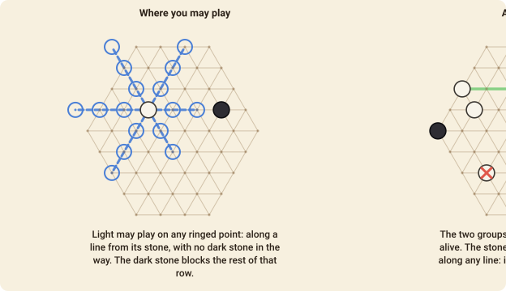

# Meridians

Meridians is a placement game by **Kanare Kato** (2021) for two players. Stones never move and are
never captured one at a time: what kills a stone is **loneliness**. A group that can see no other
group of its own colour comes off the board, and you win when your opponent has nothing left.

## The board

A hexagon of triangles, and the stones go on the **intersections**, as in Go. There are six
intersections along two of its sides and seven along the other four, which means the board has **no
middle point** — nobody can take the centre, because there isn't one. 114 points in all. Smaller
and larger boards are offered as the 5/6 and 7/8 layouts.

Every point has up to six neighbours, and lies on **three straight lines** — the three directions
of the grid. Those lines are what the whole game is about.

## Seeing

Two points are **in sight** of each other when they lie on one of those straight lines with nothing
in between. A **group** is your stones that touch one another (a single stone is a group too).

A **path** is a straight line of one or more **empty** points joining two of your groups. A group
with at least one path to another of your groups is **alive**; a group with no path at all is
**dead**.

Note what that means: your stones have to stay spread out but in sight of one another. Touching
stones are one group, so they do not see each other — a group needs a *different* group to look at.

## A turn

**Your first stone** goes on any empty point. **Your second** must not touch your first — if it
did, the two would be one group with nobody to see.

**Every turn after that**, lay a stone on an empty point that one of your own stones can see: along
a straight line, with **no stone of the other colour in between**. (One of your own in the way makes
no difference — that stone can see the same point along the same line.)

**When your turn ends**, every group of *yours* that has no path comes off the board. This does not
happen until you have had two turns, so your opening stones are safe.

There is no passing while you have a legal move.

## Winning

You win when your opponent's turn would begin with **no stones of theirs on the board**.

That can happen in two ways, and both are common: you cut the line their groups were using, so
their own turn takes them off; or they are left with one group, which by definition can see nobody.
Watch for your *own* last two groups, too — a player who is down to one group has already lost it.

A game in which neither player can lay a stone is a draw, as is one that reaches the move limit
(1200 plies); in practice the board fills, somebody runs out of paths, and that is that.

## Playing it

- **Two groups are the minimum, three are comfortable.** With two groups you depend on one line: if
  your opponent fills it, both groups die at once.
- **A stone in a line between two enemy groups is worth more than a stone anywhere else.** You are
  not taking territory; you are taking *sight*.
- **Your own stones block nothing of yours**, so a long chain of your groups along one line is
  sturdy: every neighbour on the line can see every other.
- The board has no centre, so there is no single point to fight over — the fight is over lines, and
  the long diagonals are the valuable ones.

## Move notation

A move is simply the point: `g7`. Columns are letters from the left, rows numbers from the top. A
turn with nowhere to play at all is `pass`, which is the only time a turn may pass.
