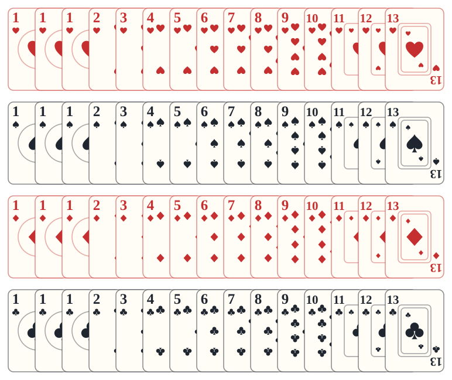

# Nyet!

Stefan Dorra's trick-taking game for two to five players. What makes it different: before every round, the players take turns **crossing out** choices on a board — each one saying what they do *not* want — and whatever is left sets the rules of the round: who leads, what is discarded, which suit is trump, which cards are super trumps and what a trick is worth. Then the leader chooses a team and the tricks are played.

## The game in short

1. **Deal.** All the cards are dealt out (15 each with 2 or 4 players, 16 with 3, 12 with 5).
2. **The Nyet! phase.** Starting with the dealer, every player crosses off one box of [the board](tab:board) until only one box is left on each line. Look at your hand first: you will want trump in the suit you hold, and a trick worth many points if you expect to win.
3. **Teams.** The first player chooses a team; see [teams](tab:tricks).
4. **Discards.** If the Discard line says so, cards are discarded or passed to the left.
5. **The tricks.** Follow the suit led, trump when you cannot, and win tricks and capture 1s as loot.
6. **Scoring.** Each team scores its tricks and loot at the round's points value, then a new round starts.

After a fixed number of rounds — **8** with 2 or 4 players, **9** with 3, **10** with 5 — the player with the most points wins.

## The cards

60 cards in the four classic suits — **spades, hearts, diamonds and clubs** — with the values **1 (three of each suit)** and 2 to 13. With three players the 11, 12 and 13 of every suit are taken out (48 cards). Values count only for winning tricks; they never score.

## The table

| Player count | Cards each | Teams | Rounds |
|---|---|---|---|
| 2 | 15 (30 left aside) | one against one | 8 |
| 3 | 16 (11–13 removed) | 1 against 2, leader's choice | 9 |
| 4 | 15 | 2 against 2 | 8 |
| 5 | 12 | 2 against 3 or 3 against 2 | 10 |

## In the game

Your hand is at the bottom, fanned: point at a card to see it twice as large, the cards you may play glow, click one to play it. The board of terms is beside the trick; boxes you may cross glow, and a crossed box shows the animal of the player who crossed it. The cards in the middle are the trick being played, each with the animal of the player who played it, and beside it the trick before. The players are listed on the right with their points, tricks, loot and the number of cards in their hands.
