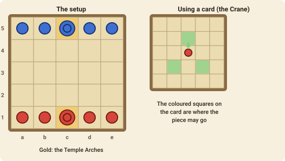

# Onitama

Onitama is a two-player duel of martial-arts schools by Shimpei Sato. The board is tiny and the pieces all move the same way, but **the moves come from cards**, and every card you play is handed to your opponent. Planning which cards you give away is as important as planning your own move.

## The goal

You win in one of two ways:

- **Way of the Stone**: capture your opponent's **Master**.
- **Way of the Stream**: move your own Master onto your opponent's **Temple Arch**, the middle square of their home row.

## The setup

The board is 5×5. Each player has a **Master** (on their Temple Arch, the middle square of their home row) and **four students** beside it. Red is at the bottom (row 1), Blue at the top (row 5).

There are **sixteen Move cards** in the game (see [Cards](tab:cards)). At the start, five are picked at random: **two go to each player**, face up, and the fifth waits **beside the board**. Red always starts.

## A turn

1. **Choose one of your two cards**, and a piece of yours that can make the move on it.
2. **Move that piece** the way the card shows. Each coloured square on the card is a move: the black square in the middle is the piece, and the others show where it may go, **forwards being towards your opponent**. Blue's cards are read from Blue's side of the table, so forwards for Blue is down the board.
3. **Pieces may jump over others.** You can't move onto your own piece or off the board. Landing on an enemy piece **captures** it.
4. **Swap cards.** The card you used goes to the side of the board, and you take the card that was waiting there. You can use it from your next turn.

The card you played goes to the side, and **your opponent will pick it up** after their next move. Think about which card you are about to hand over.

If none of your cards lets any piece move, you **pass**: but you still have to choose a card and exchange it.

Every piece, Master or student, moves in the same way. The Master is just the piece you can't afford to lose.

## Cards

The [Cards](tab:cards) tab shows all sixteen cards and their moves. A card's colour mark tells you who starts when it is the card at the side: Bingle always lets Red begin.

## Move notation

A move is the card, a colon and the squares: `tiger:c1-c3` moves the piece on c1 to c3 with the Tiger card. When nothing can move you pass, and still spend a card: `tiger:pass`.
