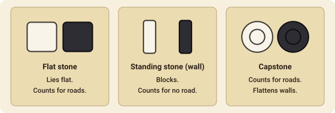
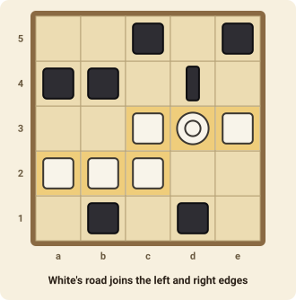
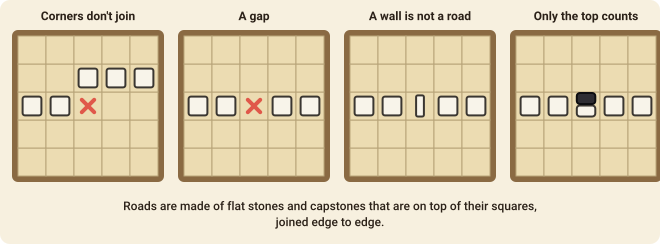
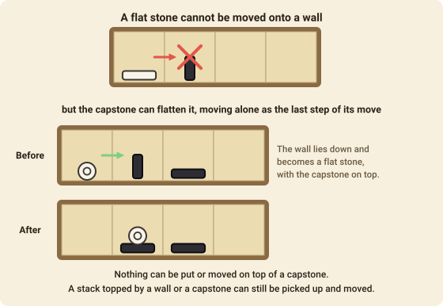

# Tak

Tak is a game of building a **road**: an unbroken chain of your stones that links two opposite sides of the board. Your opponent is building one too, so you spend as much effort blocking theirs as making your own. It was designed by James Ernest and Patrick Rothfuss, and it takes five minutes to learn.

## The goal

You win the moment you have a **road**: a chain of your own flat stones and capstones, joined edge to edge, that connects the left side of the board to the right side, or the top to the bottom. The chain may bend as it likes.

If nobody makes a road, the game ends when the board is full or when either player has used up every stone in their hand. Then whoever has more **flat stones showing** on top of the stacks wins (see [Ending without a road](#ending-without-a-road)).

## The stones

Each player has a hand of stones. There are two kinds of ordinary stone, and one special stone on boards of 5×5 and larger.

| | Stone | What it does |
|---|---|---|
|  | **Flat stone** | Lies flat. It counts towards roads and towards the final flat count. Other stones can be stacked on it. |
|  | **Standing stone** (a **wall**) | Stands on its edge. It blocks: it is no part of a road, and nothing can be moved on top of it. |
|  | **Capstone** | Counts towards roads and can never be covered. A capstone can flatten a wall. |

Standing stones and flat stones come from the same supply: the choice is made when you place a stone. How many stones you have depends on the board:

| Board | Stones | Capstones |
|---|---|---|
| 3×3 | 10 | – |
| 4×4 | 15 | – |
| 5×5 | 21 | 1 |
| 6×6 | 30 | 1 |
| 7×7 | 40 | 2 |
| 8×8 | 50 | 2 |

## Starting the game

Each player's first turn is special: you place one **flat stone of your opponent's colour** on any empty square. White goes first, so White puts a black stone down, then Black puts a white stone down. From then on, White moves again and the players alternate, each playing their own colour.

## On your turn

You do exactly one of two things:

1. **Place** a stone from your hand on an empty square, or
2. **Move** a stack you control.

### Placing a stone

Choose a flat stone, a standing stone or your capstone and put it on any empty square. A stone you place always starts a new stack of one.

### Stacking & Movement

Stones pile up. A square can hold a **stack** of any number of stones, and a stack can contain both colours. **Whoever's stone is on top controls the stack**, so you may move any stack with your own stone on top, however many enemy stones lie underneath.

To move a stack:

1. **Pick up** one or more stones from the *top* of the stack. You may take the whole stack, but never more than the **carry limit**, which is the size of the board (five on a 5×5 board). The stones you leave behind stay where they are.
2. Pick a **direction**: up, down, left or right. You can't go diagonally, and you can't turn or double back during the move.
3. **Drop** the stones you carry as you walk, **at least one on every square you enter**, until your hand is empty. You can drop several on one square before moving on. The stones keep their order: the *bottom* stone of the group you picked up is dropped first.

. Bottom: the top three stones of a four-stone stack, two dropped on the next square and one on the one after (3a1>21).")

Some things to know:

- Moving just one stone is a move too: a single stone can step to a neighbouring square, on top of whatever stack is there.
- A stack can be moved onto any square that is **empty** or whose top stone is a **flat stone** (of either colour), including your own.
- A stack cannot enter a square topped by a **wall** or a **capstone**, and it cannot move off the board. The one exception is the capstone's flattening, below.
- Putting your stones on top of an opponent's flat stones *captures* them in the sense that they are covered: they stop counting for roads and for the flat count until the stack above is moved away.

## Roads

A road is a chain of **flat stones and capstones**, each touching the next along an edge (not at a corner), that runs from one side of the board to the opposite side: left to right, or top to bottom. Only the **top stone of each square** matters: a square counts as yours if your flat stone or capstone is on top of it, whatever lies underneath.

These are not roads:

- Stones that touch only at **corners** are not joined.
- A **gap** breaks the chain until it is filled.
- A **standing stone** is not part of a road, even if it is your own.
- A square whose top stone is an **enemy** stone doesn't count for you, even if one of your stones lies underneath.

If one move completes a road for *both* players, the player who made the move wins.

## Walls

A standing stone (a **wall**) is a barrier. It is your best way to stop a road: no stack can be moved onto it, so the chain has to go round it, and an opponent who needs the square must first get rid of the wall. The price is that a wall is **not part of your own road**, and it spends one of your stones.

A wall can be changed back into a flat stone only by a capstone (see below). Stones can never be put on top of a wall, but a stack with a wall on top can still be picked up and moved by its owner, which leaves the stones underneath uncovered.

## The capstone

The capstone is the most powerful stone. It **counts for roads** like a flat stone, and it **can never be covered**: no stone may be placed or moved onto it. It also has one special power: it can **flatten a wall**.

A capstone flattens a wall when it moves onto the wall's square:

- the capstone must be **alone** when it lands, that is, it must be the only stone dropped on that square, and
- the wall must be on the **last square** of the move.

The wall is then turned flat and counts as a flat stone again (of its owner's colour), with the capstone on top of it. A stack that contains a capstone can do this too, as long as the capstone is dropped last and alone on the final square.

## Ending without a road

The game also ends when **the board is full**, or when **either player has no stones left in their hand** (flat stones, walls and capstone all used). Count the **flat stones that are on top of stacks**: walls and capstones do not count. The player with more wins, and if the counts are equal the game is a draw.

So a stone buried under an enemy stone is lost for the count, and covering your opponent's flat stones is a real way to win the long game.

## Move notation

Tak moves are written in Portable Tak Notation (PTN). Squares are a letter and a number: `a1` is the bottom-left corner.

- **Placing**: `a1` places a flat stone. `S` before the square places a standing stone (`Sc3`) and `C` places the capstone (`Cd4`).
- **Moving**: *count, square, direction, drops*. The direction is `+` (up), `-` (down), `<` (left) or `>` (right). The count is the number of stones picked up (1 if left out). The drops are one digit per square entered, bottom stone first, and can be left out when everything is dropped on the first square.

| Move | What it does |
|---|---|
| `c3+` | Moves the top stone of c3 up one square. |
| `2d2<` | Moves two stones from d2 one square left. |
| `3c3>111` | Picks up three stones from c3 and drops one on each of d3, e3 and f3. |
| `3a1>21` | Picks up three from a1, drops two on b1 and one on c1. |
