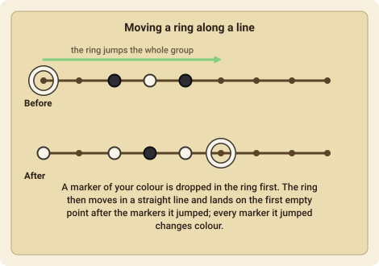
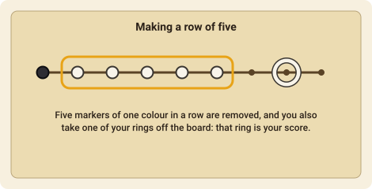

# Yinsh

Yinsh is a game of **rings and markers** by Kris Burm. Each move leaves a trail of markers, and the same markers flip colour when a ring jumps them. You score by making a row of five of your colour, which also takes one of your rings off the board.

## The goal

Be the first player to **remove three of your own rings**. (In the one-ring *blitz* variant, the first ring wins.) If the last marker is placed and nobody has won, the player who has removed more rings wins, and equal counts are a draw.

## The pieces and the board

The board has **85 points** where lines cross, in lines that run in three directions. Each player has **5 rings** (white or black). The two players share a **pool of 51 markers**, which are white on one side and black on the other: a marker shows the colour of the side it is lying on.

## Setting up

Starting with White, the players take turns **placing one ring** each on any empty point, until all 10 rings are on the board. Then White makes the first move.

## A turn

On your turn you choose one of **your rings** and move it:

1. **Drop a marker** of your colour inside the ring you've chosen (on its point).
2. **Move the ring** in a straight line along the lines to an empty point. The ring may **pass over empty points** and over **groups of markers**, but it can't pass over or land on another ring.
3. If the ring jumps a group of markers (one or more in a row), it must **land on the first empty point after** the group, and every marker it jumped is **turned over** to the other colour.

You can't stop a ring on a marker and rings can't move off the lines.

## Rows of five

Whenever a row of **five markers of one colour** lies on a line, its owner removes it:

- take the **five markers** and also **one of your own rings** off the board. That ring is a point for you.
- A row of **more than five** lets you choose any five in a line. If several rows are made at once, they are removed one after another, so overlapping rows can break each other.
- If one move makes rows for **both** players, you remove yours first, and then your opponent removes theirs.
- The markers you remove go back to the pool.

Because your *opponent's* markers can be turned into your colour by a jumping ring, and your own into theirs, a row you build can be broken by one move, and a move can complete a row for either player.

## If you can't move

A player who can't move any ring **passes**. If the game goes on for 1000 moves, it is decided on the rings removed so far.

## Move notation

Points are named like the published board: a column letter `a`–`k` and a row number, from `a2` to `k10`.

- **Setup**: `e5` places a ring on e5.
- **A move**: `e5-e9` drops a marker in your ring on e5 and moves the ring to e9.
- **A row**: `row:b2-b6` removes the five markers from b2 to b6, and `ring:e9` then removes your ring on e9.
- `pass` is allowed only when no ring can move.
